# 力扣每日一题

## 9.1 清理教室的最少移动(BFS)

[3568. 清理教室的最少移动 - 力扣（LeetCode）](https://leetcode.cn/problems/minimum-moves-to-clean-the-classroom/description/?envType=daily-question&envId=2026-09-13)

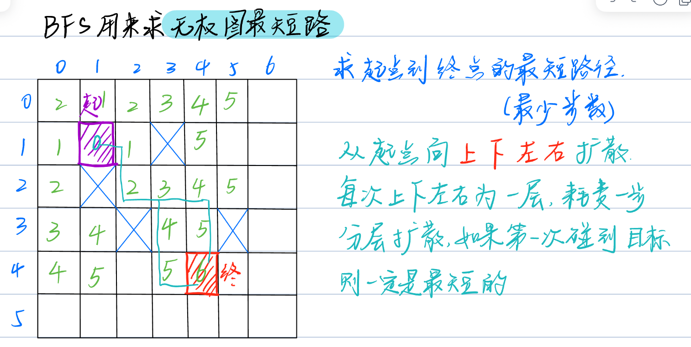

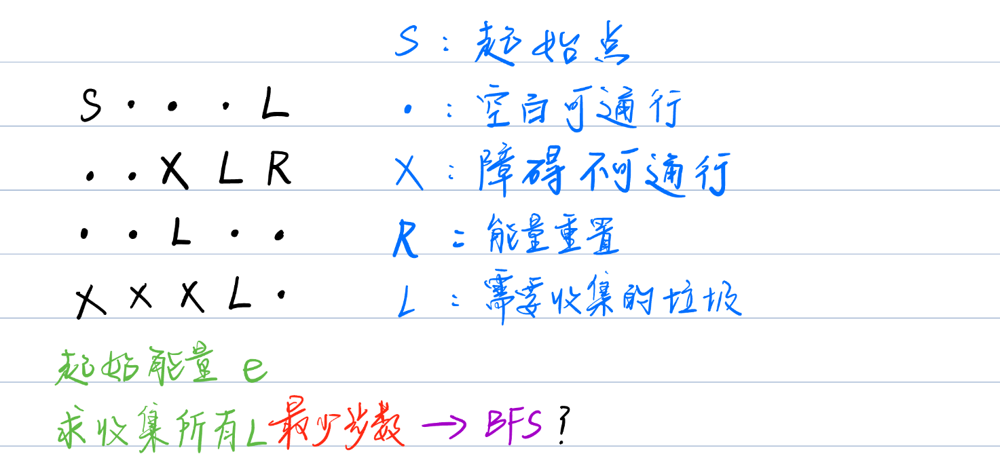

但是此题为**带状态的BFS**

- 当前能量
- 当前所有垃圾的状态

```c++
struct Node
{
    int x, y, e, mask, step;
};
class Solution {
public:
    int minMoves(vector<string>& classroom, int energy) {
        int n = classroom.size(), m = classroom[0].size();
        
        vector<vector<int>> idx(n, vector<int>(m, 0));
        //垃圾编号
        
        int dx[4] = {0, 0, -1, 1}, dy[4] = {1, -1, 0, 0};
        int sx = 0, sy = 0, cnt = 0;
        for(int i = 0; i < n; i ++)
            for(int j = 0; j < m; j ++)
            {
                if(classroom[i][j] == 'S')
                {
                    sx = i;
                    sy = j;
                }else if(classroom[i][j] == 'L')
                {
                    idx[i][j] = 1 << cnt ++;
                    //用二进制来存垃圾编号
                    //如：第一个垃圾为 001
                    //   第二个垃圾为 010
                    //   第三个垃圾为 100
                }
            }
        int sum = 1 << cnt;
        //垃圾总共的状态
        //如两个垃圾有以下几种状态
        //00   01   10   11 共4种 即 1 << 2 = 100(二进制) = 4
        vector<vector<vector<vector<bool>>>> vis(n, vector(m, vector(energy + 1, vector<bool>(sum, false))));
        //所有状态是否被走过
        queue<Node> que;
        que.push({sx, sy, energy, 0, 0});
        //学生在的格子的状态
        vis[sx][sy][energy][0] = true;
        
        while(!que.empty())
        {
            auto [x, y, e, mask, step] = que.front();
            que.pop();
            if(mask == sum - 1)
            {
                //sum - 1代表的是所有垃圾被捡了
                return step;
            }
            if(e == 0)continue;
            //没能量了，不能移动了
            for(int i = 0; i < 4; i ++)
            {
                int nx = x + dx[i];
                int ny = y + dy[i];
                if(nx < 0 || nx >= n || ny < 0 || ny >= m || 
                   classroom[nx][ny] == 'X')continue;
                //越界或者已经访问过此状态，不进行操作
                int new_e = classroom[nx][ny] == 'R' ? energy : e - 1;
                int new_mask = mask | idx[nx][ny];
                if(!vis[nx][ny][new_e][new_mask])
                {
                    que.push({nx, ny, new_e, new_mask, step + 1});
                    vis[nx][ny][new_e][new_mask] = true;
                }
            }
        }
        return -1;
    }
};
```

## 9.2—9.3 构造奇偶一致的数组(Ⅰ、Ⅱ)

[3875. 构造奇偶一致的数组 I - 力扣（LeetCode）](https://leetcode.cn/problems/construct-uniform-parity-array-i/description/?envType=daily-question&envId=2026-09-13)


[3876. 构造奇偶一致的数组 II - 力扣（LeetCode）](https://leetcode.cn/problems/construct-uniform-parity-array-ii/?envType=daily-question&envId=2026-09-13)


## 9.4—9.5 最小稳定下标(Ⅰ、Ⅱ)

[3903. 最小稳定下标 I - 力扣（LeetCode）](https://leetcode.cn/problems/smallest-stable-index-i/?envType=daily-question&envId=2026-09-13)


[3904. 最小稳定下标 II - 力扣（LeetCode）](https://leetcode.cn/problems/smallest-stable-index-ii/?envType=daily-question&envId=2026-09-13)


## 9.6—9.7 不同的子序列(Ⅰ、Ⅱ)(动态规划)

[115. 不同的子序列 - 力扣（LeetCode）](https://leetcode.cn/problems/distinct-subsequences/?envType=daily-question&envId=2026-09-13)

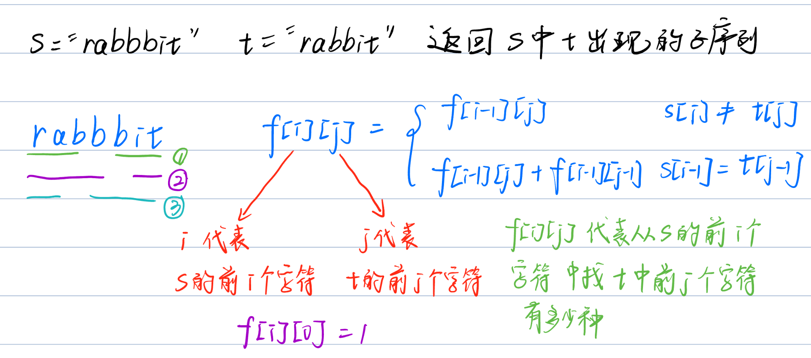

i = 1, j = 1 s = "r"     t = "r" 1

f[i][0\] = 1

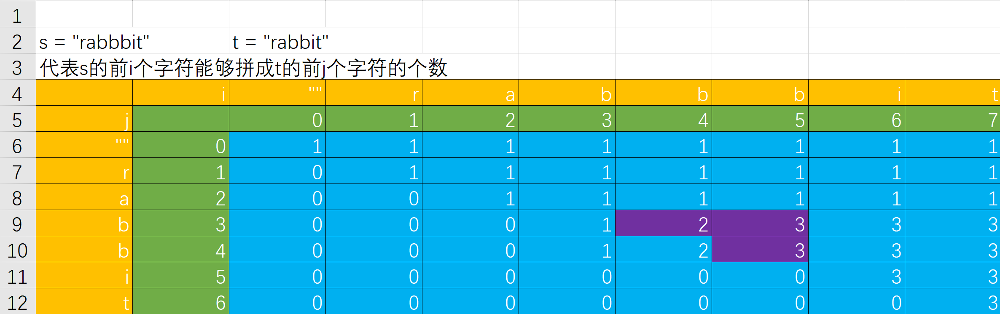


[940. 不同的子序列 II - 力扣（LeetCode）](https://leetcode.cn/problems/distinct-subsequences-ii/?envType=daily-question&envId=2026-09-13)

## 9.12—9.19 重叠问题

**9.12**

[1235. 规划兼职工作 - 力扣（LeetCode）](https://leetcode.cn/problems/maximum-profit-in-job-scheduling/description/)

动态规划 + 二分查找

**9.13**

[835. 图像重叠 - 力扣（LeetCode）](https://leetcode.cn/problems/image-overlap/description/?envType=daily-question&envId=2026-09-19)

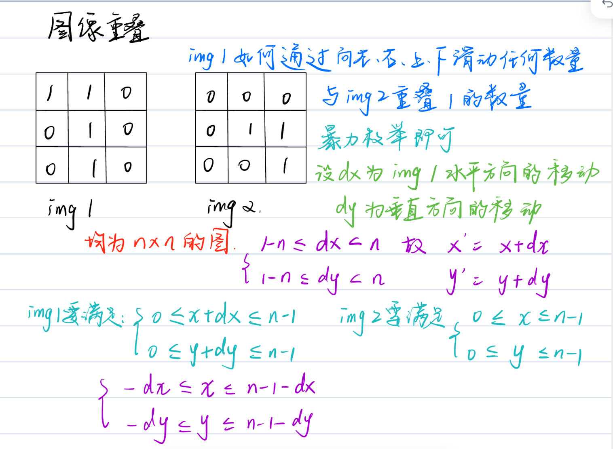

**9.14**

[836. 矩形重叠 - 力扣（LeetCode）](https://leetcode.cn/problems/rectangle-overlap/?envType=daily-question&envId=2026-09-19)

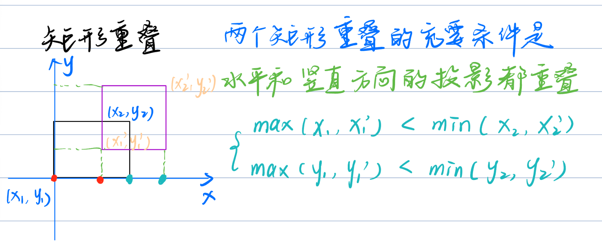

**9.15**

[2472. 不重叠回文子字符串的最大数目 - 力扣（LeetCode）](https://leetcode.cn/problems/maximum-number-of-non-overlapping-palindrome-substrings/?envType=daily-question&envId=2026-09-19)

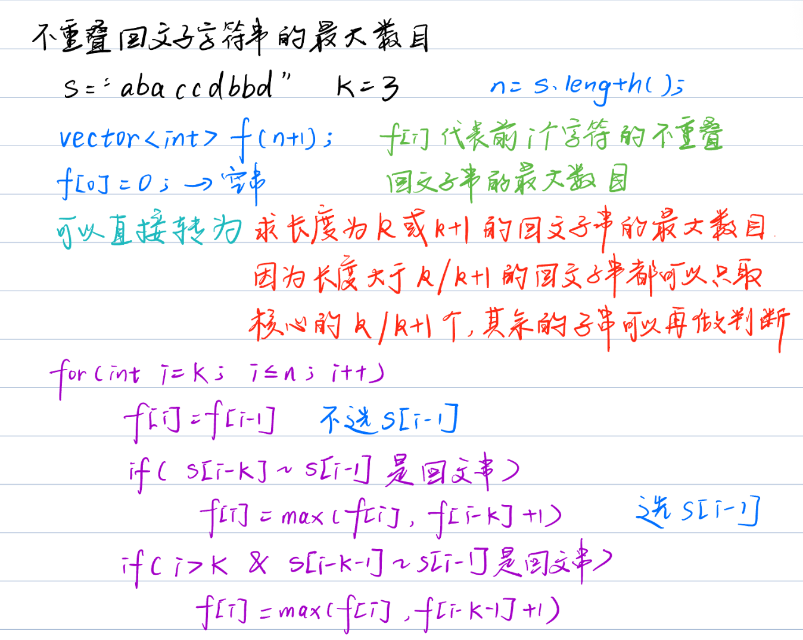

**9.16**

[1621. 大小为 K 的不重叠线段的数目 - 力扣（LeetCode）](https://leetcode.cn/problems/number-of-sets-of-k-non-overlapping-line-segments/?envType=daily-question&envId=2026-09-19)


**9.17**

[1477. 找两个和为目标值且不重叠的子数组 - 力扣（LeetCode）](https://leetcode.cn/problems/find-two-non-overlapping-sub-arrays-each-with-target-sum/description/?envType=daily-question&envId=2026-09-19)

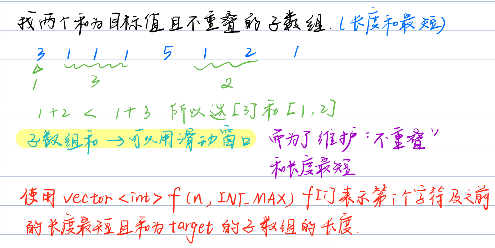

**9.18**

[1520. 最多的不重叠子字符串 - 力扣（LeetCode）](https://leetcode.cn/problems/maximum-number-of-non-overlapping-substrings/?envType=daily-question&envId=2026-09-19)

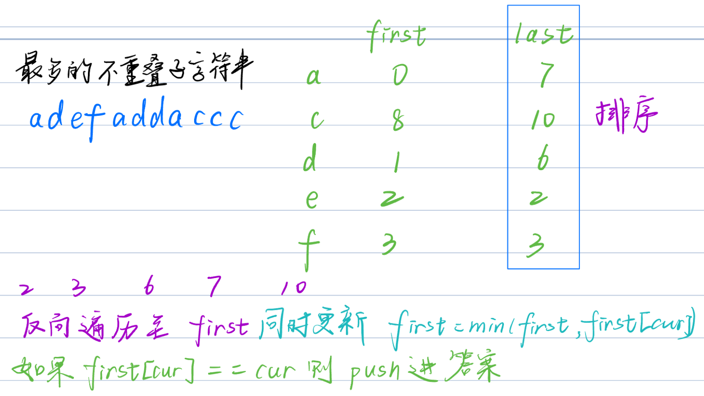

**9.19**

[1401. 圆和矩形是否有重叠 - 力扣（LeetCode）](https://leetcode.cn/problems/circle-and-rectangle-overlapping/?envType=daily-question&envId=2026-09-19)

## 9.26—10.9 括号问题

**9.26**

[1807. 替换字符串中的括号内容 - 力扣（LeetCode）](https://leetcode.cn/problems/evaluate-the-bracket-pairs-of-a-string/description/?envType=daily-question&envId=2026-10-03)

替换每队括号中间的字符串。

1. 要知道字符串对应关系——哈希表
2. 括号中间替换——双指针指向左右括号
3. 遍历字符串时，==需要避免括号内的字母加了两遍==

```c++
class Solution {
public:
    string evaluate(string s, vector<vector<string>>& knowledge) {
        string res = "";
        int n = s.length(), m = knowledge.size();
        unordered_map<string,string> mp;
        for(int i = 0; i < m; i ++)   
            mp[knowledge[i][0]] = knowledge[i][1];
        int l = -1, r = 0;				
        string tmp = "";
        while(r < n)
        {
            if(s[r] == '(')
            {
                l = r;
            }
            else if(s[r] == ')')
            {
                tmp = s.substr(l + 1, r - l - 1);
                if(mp.find(tmp) != mp.end())
                    res += mp[tmp];
                else 
                    res += '?';
                l = -1;
            }
            else if(l == -1) 		//当l == -1时，说明当前s[r]不在括号里
                res += s[r];
            ++ r;
        }
        return res;
    }
};
```

**9.27**

[1190. 反转每对括号间的子串 - 力扣（LeetCode）](https://leetcode.cn/problems/reverse-substrings-between-each-pair-of-parentheses/?envType=daily-question&envId=2026-10-03)

分层处理

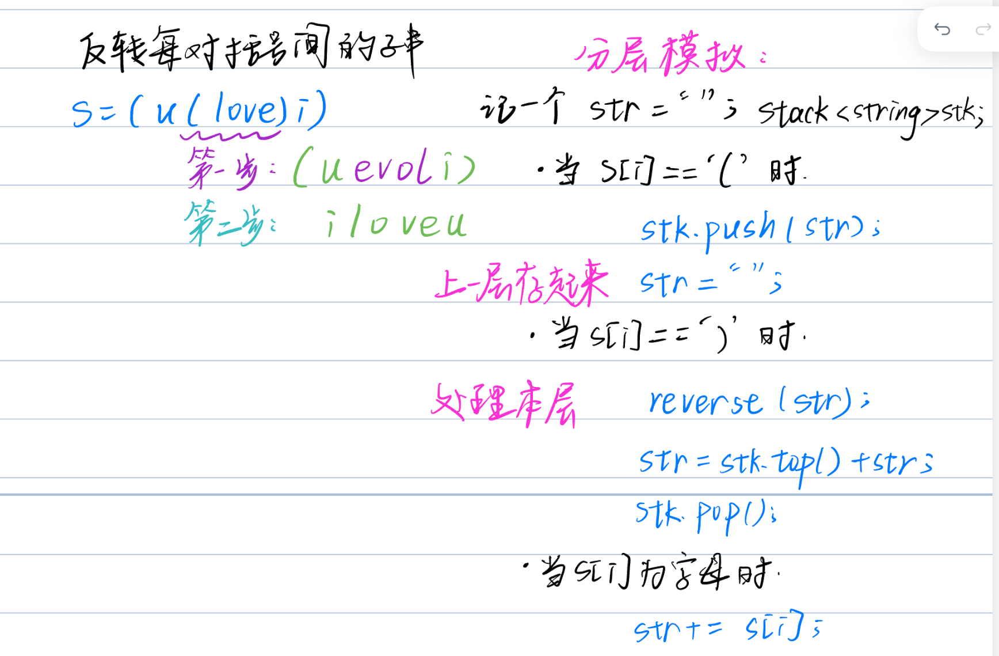

同类型分层处理：

[856. 括号的分数 - 力扣（LeetCode）](https://leetcode.cn/problems/score-of-parentheses/?envType=daily-question&envId=2026-10-06)


**9.28**

[1614. 括号的最大嵌套深度 - 力扣（LeetCode）](https://leetcode.cn/problems/maximum-nesting-depth-of-the-parentheses/description/?envType=daily-question&envId=2026-10-03)

记录左括号出现的最大深度就行了。

比如 ( ( ) ( ) )

i = 0, lcnt = 1;		==i = 1, lcnt = 2;==		i = 2, lcnt = 1; 

==i = 3, lcnt = 2;==		i = 4, lcnt = 1;		i = 5, lcnt = 0;

**9.29**

[2267. 检查是否有合法括号字符串路径 - 力扣（LeetCode）](https://leetcode.cn/problems/check-if-there-is-a-valid-parentheses-string-path/?envType=daily-question&envId=2026-10-03)


**9.30**

[1111. 有效括号的嵌套深度 - 力扣（LeetCode）](https://leetcode.cn/problems/maximum-nesting-depth-of-two-valid-parentheses-strings/submissions/?envType=daily-question&envId=2026-10-03)

先算出括号的最大层数，因为要分成两部分，并且两部分中括号层数较大的那个值要最小，所以采用平分层数的方法。


**10.1**


**10.2**


**10.3**

[32. 最长有效括号 - 力扣（LeetCode）](https://leetcode.cn/problems/longest-valid-parentheses/?envType=daily-question&envId=2026-10-03)

当s[i] == ')'时需要进行分类讨论

**10.4**

[678. 有效的括号字符串 - 力扣（LeetCode）](https://leetcode.cn/problems/valid-parenthesis-string/description/?envType=daily-question&envId=2026-10-06)

注意一种情况  ==*(== 这种情况是无法形成有效字符串的

所以必须存储 星号* 和 左括号 ( 的位置，以免出现 *(  这种情况被误判成有效字符串

**10.5**

[856. 括号的分数 - 力扣（LeetCode）](https://leetcode.cn/problems/score-of-parentheses/?envType=daily-question&envId=2026-10-06)

==同9.27的分层模拟==


**10.6**

[921. 使括号有效的最少添加 - 力扣（LeetCode）](https://leetcode.cn/problems/minimum-add-to-make-parentheses-valid/?envType=daily-question&envId=2026-10-06)


**10.7**

[301. 删除无效的括号 - 力扣（LeetCode）](https://leetcode.cn/problems/remove-invalid-parentheses/?envType=daily-question&envId=2026-10-06)

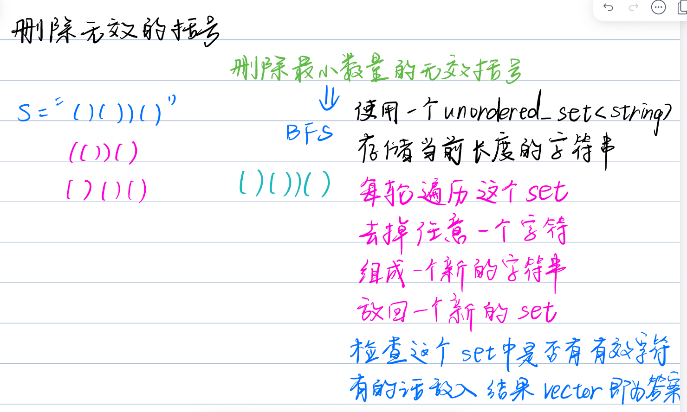

**10.8**

[1021. 删除最外层的括号 - 力扣（LeetCode）](https://leetcode.cn/problems/remove-outermost-parentheses/?envType=daily-question&envId=2026-10-10)

维护左括号个数

同==9.30的将括号分为两部分==

```c++
class Solution {
public:
    string removeOuterParentheses(string s) {
        string res = "";
        int n = s.length(), cnt = 0;
        for(int i = 0; i < n; i ++)
        {
            if(s[i] == '(')
            {
                ++ cnt;
                if(cnt > 1)
                    res += s[i];
            }
            else
            {	
                //需要注意的是：
                //先将右括号放进答案里再去消左括号
                if(cnt > 1)
                    res += s[i];
                -- cnt;
            }
        }
        return res;
    }
};
```

**10.9**

[1541. 平衡括号字符串的最少插入次数 - 力扣（LeetCode）](https://leetcode.cn/problems/minimum-insertions-to-balance-a-parentheses-string/description/?envType=daily-question&envId=2026-10-10)

维护左括号个数，每次对右括号进行处理。


## 10.10 最小差值平方

[2333. 最小差值平方和 - 力扣（LeetCode）](https://leetcode.cn/problems/minimum-sum-of-squared-difference/?envType=daily-question&envId=2026-10-10)


# hot100

## 二分法

[35. 搜索插入位置 - 力扣（LeetCode）](https://leetcode.cn/problems/search-insert-position/description/?envType=study-plan-v2&envId=top-100-liked)

[74. 搜索二维矩阵 - 力扣（LeetCode）](https://leetcode.cn/problems/search-a-2d-matrix/?envType=study-plan-v2&envId=top-100-liked)

[34. 在排序数组中查找元素的第一个和最后一个位置 - 力扣（LeetCode）](https://leetcode.cn/problems/find-first-and-last-position-of-element-in-sorted-array/description/?envType=study-plan-v2&envId=top-100-liked)

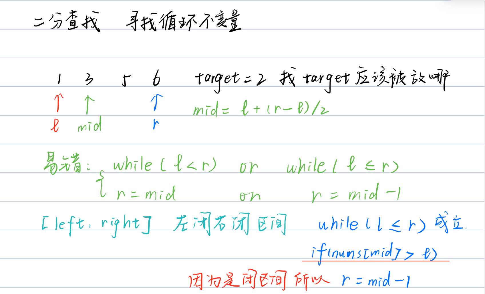

>  不变量 = ==维护「左/右已确定、答案只可能在未定区间」这个结构，不是维护某一个具体数值。==

